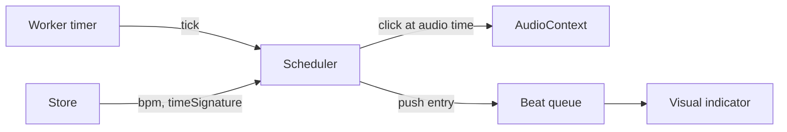

# Audio engine

Code in `src/audio/`. It imports state modules but nothing from the UI. `main.ts` creates the engine and exports it as `engine`.

## Pieces

- `engine.ts`: `createEngine(store, deps?)` returns `start()`, `stop()`, `currentTime()` and `beatQueue`. Nothing audio-related exists until `start()`, which must run in a user gesture. It keeps the store's `running` flag in step with playback.
- `scheduler.ts`: a lookahead scheduler. Each tick (`TICK_MS` 25) schedules, on the Web Audio clock, every beat due within `SCHEDULE_AHEAD_S` (0.1 s). The first beat comes `START_DELAY_S` (0.05 s) after start.
- `workerTickSource.ts` and `scheduler.worker.ts`: the tick source is a module Web Worker, so a hidden tab still ticks on time.
- `click.ts`: `scheduleClick(ctx, time, level)` makes one click at the accent level (`strong`, `medium`, `normal`).
- `beatQueue.ts`: the queue the visual indicator reads. Each entry is `{ beat, audioTime, level, beatsPerBar }`.

## Behaviour

- Tempo and time signature are read when each beat is scheduled, so a change lands on the next unscheduled beat. A new time signature restarts the bar at beat 0.
- A late tick re-anchors to `now + START_DELAY_S` rather than playing past beats.
- Each tick prunes queue entries older than `QUEUE_RETENTION_S` (1 s) and forgets finished clicks, which bounds memory in a hidden tab.
- `stop()` silences clicks scheduled but not yet sounded and clears the queue.

## Failure handling

- `scheduler.start()` rolls back and rethrows if the tick source throws, so a retry works.
- If the context is not `running`, `start()` calls `resume()` (this covers iOS `interrupted`). It rejects if the context stays down. A `closed` context is replaced on the next start.
- A context `statechange` away from `running`, or a tick source `onError` (worker load failure or crash), stops the engine and sets `running` false. The dead worker is terminated and a new one is made on the next start.
- Setting `running: false` in the store stops the engine.
- On iOS the engine sets `navigator.audioSession.type` to `playback` where it exists.
